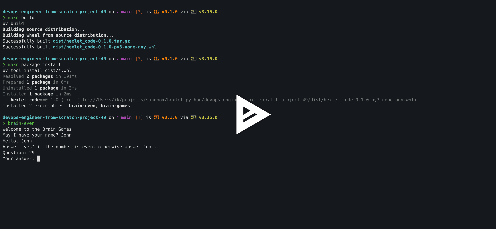
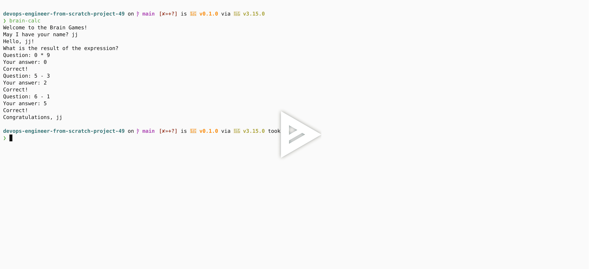
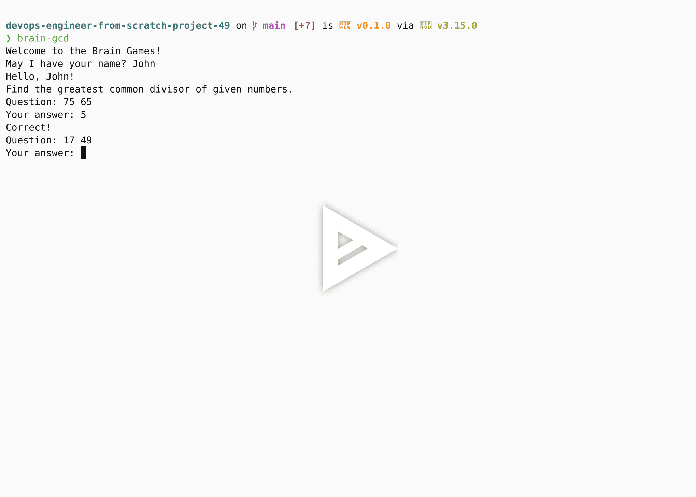
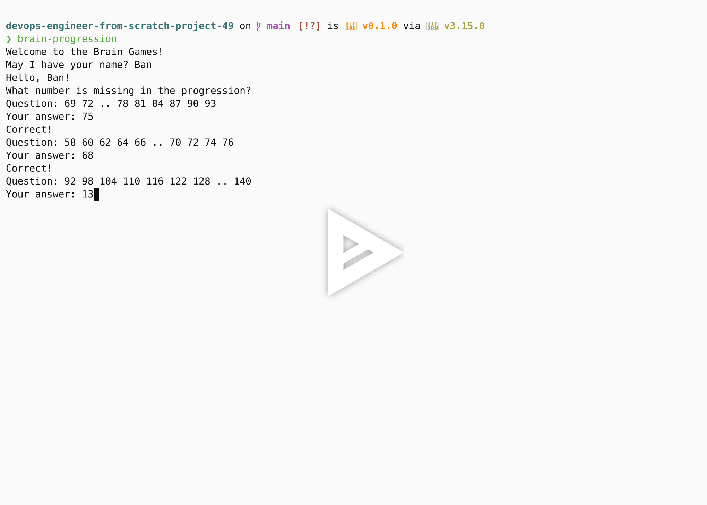
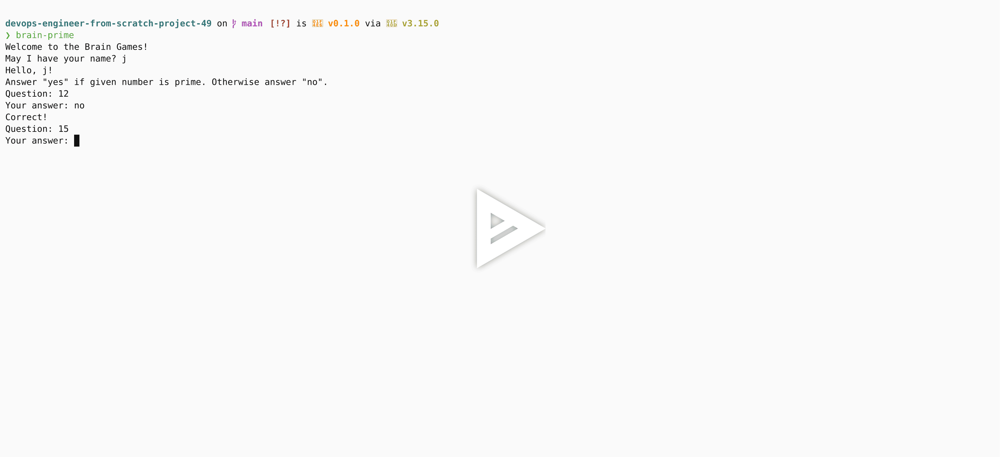

# Игры разума (Python)

[](https://github.com/ikurennyi/devops-engineer-from-scratch-project-49/actions)

Проект представляет из себя набор мини-игр (Вычисление операции, Определение четного числа, Поиск наибольшего общего делителя и пр.) запускаемых в терминале.

Цель проекта - столкнуться с небольшим проектом на Python воочию: изучить структуру, подключить зависимости, такие как PyTest для тестирования и Ruff для форматирования и линтинга.

Проект выполнен как тестовое задание от Hexlet по первому пройденному модулю.

## Стек

- Python (3.14)

## Установка

```bash
git clone https://github.com/ikurennyi/devops-engineer-from-scratch-project-49.git
cd devops-engineer-from-scratch-project-49
make install
```

1. If you want ot play:
    1. `brain-even` - run `make brain-even`
    2. `brain-calc` - run `make brain-calc`
    3. `brain-gcd` - run `make brain-gcd`
    4. `brain-progression` - run `make brain-progression`
    5. `brain-prime` - run `make brain-prime`

* Check `Makefile` for all possible commands
* Check [Asciinema section](#asciinema) to see demos.

## <a id="asciinema">Asciinema demos</a>:

#### Even:

[](https://asciinema.org/a/1269982)

#### Calc:

[](https://asciinema.org/a/1270100)

#### GCD:

[](https://asciinema.org/a/1270104)

#### Progress:

[](https://asciinema.org/a/1270108)

#### Prime:

[](https://asciinema.org/a/1270114)

---

<details>
<summary>Автоматические тесты Хекслета</summary>

Тесты запускаются на каждый коммит. За запуск отвечает файл `.github/workflows/hexlet-check.yml` — не удаляйте и не переименовывайте ни его, ни репозиторий.

</details>

## О Хекслете

[Хекслет](https://ru.hexlet.io/) — школа программирования: авторские программы обучения с практикой, поддержкой наставников и реальными проектами, которые остаются в резюме. Этот репозиторий — один из таких проектов.
